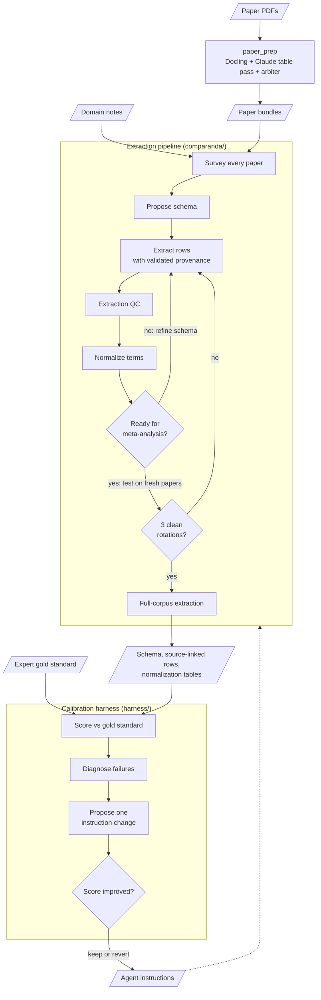

# Comparanda

Turn a pile of scientific papers into a structured, source-linked dataset ready for meta-analysis.

Give Comparanda a research area and the PDFs.
It works out what to extract, extracts each finding as its own row, links every value to the passage or table cell it came from, and reconciles terminology across decades of literature.
It runs as [Claude Code](https://docs.claude.com/en/docs/claude-code) agents backed by deterministic Python tooling, with a calibration harness that scores the agents against an expert gold standard and improves their instructions.

Built by [MetaCensus](https://github.com/metacensus), a nonprofit working on open, reusable evidence for meta-analysis.

> This repository contains the system only.
> Evaluation runs, extracted datasets and the papers they come from are not published here, because the papers are under copyright.



## Why

Extraction tools like Covidence and Elicit assume someone has already designed the schema.
Deciding which fields matter, at what granularity, and how to map old terminology onto new is the slow part, and every group redoes it by hand.
Comparanda discovers the schema from the papers and extracts at a granularity that can answer more than one question.

## Features

- **Schema discovery.** A survey agent catalogs every paper; a schema agent turns the surveys into a versioned YAML schema with guidance for each field.
- **One finding per row.** Each row is one result for one group, outcome and measurement, with the control group as its own row.
- **Validated provenance.** Every value cites a quote, table cell or figure. A validator checks that the quote exists, the value appears in it, and derived numbers add up; hooks block any unvalidated output.
- **Certainty and missingness.** Values are marked verbatim, derived or inferred, and clean or ambiguous. Missing values carry a reason, and a reported zero is never treated as missing.
- **Extraction QC.** Each extraction is checked against its paper's survey and the schema, with targeted repairs sent back to the original extractor session.
- **Lossless normalization.** Raw values map to standardized IDs (lookup table first, LLM second) while the raw value is kept, with a ledger of every mapping decision.
- **Readiness testing.** A reviewer agent asks whether the data supports meta-analysis and proposes the smallest schema fix; the schema must then hold across three fresh subsets of papers in a row.
- **Human review.** A risk-ranked review queue, review packets, and audited corrections that survive re-extraction.
- **PDF preparation.** `paper_prep` turns PDFs into bundles with Docling, a Claude pass over each table, and an optional arbiter. Every LLM call has a cost cap and can only read its inputs and write one file.
- **Self-calibration.** The harness scores runs against your gold standard, traces failures to the responsible instruction, and tests one general fix at a time, keeping or reverting it on the score.
- **Domain-independent.** Agents, scripts and hooks contain no domain knowledge; everything specific to a research area lives in its own repository.

## Status

Research software under active development, built on its first domain: DPYD pharmacogenomics (gene variants that predict severe toxicity from fluoropyrimidine chemotherapy).
Recent runs were executed mostly with GLM 5.3 Flash.
A port of the pipeline to [Temporal](https://temporal.io/) is in progress.

Considerations:

- Comparanda is built to be general, but the default gold-standard layout expects a biomedical effect-size spreadsheet.
- Cost caps exist only in `paper_prep`.
- Workflow steps are enforced through agent instructions; the Temporal port will move them into code.

## Responsibility boundary

Comparanda prepares evidence.
It does not choose the research question, select studies, pick a statistical model, run the meta-analysis, or make guideline or policy recommendations.
Its output should carry what an analyst needs to:

1. explore candidate research questions and choose one;
2. decide inclusion and exclusion;
3. choose a statistical model; and
4. build the model's inputs and run it.

Known analyst decisions can test whether the extraction preserved enough evidence for those steps; Comparanda doesn't try to reproduce them.

## Requirements

- [Claude Code](https://docs.claude.com/en/docs/claude-code) CLI, installed and authenticated. Model usage is billed to your Claude Code account.
- [uv](https://docs.astral.sh/uv/) and Python 3.12+, with `python3` on your `PATH` for the hooks.
- `jq`, for the harness guard hook.
- Model access: most extraction agents use `claude-sonnet-5[1m]`, the survey agent `haiku`, and harness agents `haiku`, `sonnet` or `opus`. Change the `model:` line in an agent file if your account lacks a model; the harness eval model can also be set with `COMPARANDA_EVAL_MODEL`.

## Getting started

Follow [`docs/getting-started.md`](./docs/getting-started.md) for a full run: set up a domain repository, turn open-access PDFs into bundles, run the extraction pipeline, and optionally evaluate against your own gold standard.

To prepare papers on their own:

```bash
cd comparanda/scripts/paper_prep && uv sync

# One paper
uv run python -m paper_prep <paper_id> --pdf /abs/path/paper.pdf \
  --output-root /abs/path/data/processed

# A corpus: PDFs named like "Smith 2024 (J Example) [12345678].pdf"
uv run python -m paper_prep.batch --subset subset.json \
  --pdfs-dir /abs/path/pdfs --bundle-out /abs/path/data/processed
```

Run these from a regular terminal, not inside a Claude Code session.
See the [`paper_prep` README](./comparanda/scripts/paper_prep/README.md) for the subset format, budgets and permission scoping.

Paper IDs look like `smith_2024_12345678` (author, year, document ID).
For biomedical papers the document ID is usually the PubMed ID.

## How it works

This repository has two parts: the extraction pipeline in [`comparanda/`](./comparanda/) and the calibration harness in [`harness/`](./harness/).

### Extraction pipeline

[`comparanda/CLAUDE.md`](./comparanda/CLAUDE.md) orchestrates the run and hands each phase to an agent in [`comparanda/.claude/agents/`](./comparanda/.claude/agents/).
[`comparanda/AGENT_INDEX.md`](./comparanda/AGENT_INDEX.md) documents agent scopes, file contracts, scripts, hooks and resume behavior.

| Phase | Agent | What happens |
|---|---|---|
| 0 | survey, schema-proposer, extractor, normalizer, ma-critique | One-time onboarding: each agent writes its own domain reference from your notes. |
| 0.5 | `schema-proposer` | Writes the survey schema. |
| 1 | `survey`, `subset-selector` | Surveys every paper and picks 3–4 diverse papers to start with. |
| 2 | `schema-proposer` | Proposes the extraction schema (first iteration only). |
| 3a | `extractor` | Extracts rows from each paper's bundle through the extraction SDK. |
| 3a-QC | `extraction-qc` | Checks each extraction against its survey and the schema. |
| 3b | `normalizer` | Maps raw values to standardized IDs. |
| 3.5 | `ma-critique` | Judges meta-analysis readiness and picks the next action. |
| 4 | `schema-proposer` | Applies schema changes and loops back to 3a. |
| 5 | `subset-selector` | Rotates to fresh papers until the schema survives three clean rotations. |
| 6 | `extractor`, `extraction-qc`, `normalizer` | Final full-corpus extraction in bounded batches. |

A run also leaves a versioned schema, normalization tables, critiques, and an append-only observation log that lets the next session resume.
Hooks in `comparanda/.claude/hooks/` block direct writes to extraction files and keep the extractor from stopping before a validated finalization ([guardrails](./comparanda/AGENT_INDEX.md#guardrails)).
Scripts are indexed in [`comparanda/scripts/README.md`](./comparanda/scripts/README.md), and the SDK and normalization contracts are in `comparanda/docs/`.

### Calibration harness

The harness runs the pipeline, scores it against a gold standard, and improves the agents' instructions one change at a time.
See [`harness/CLAUDE.md`](./harness/CLAUDE.md) and [`harness/AGENT_INDEX.md`](./harness/AGENT_INDEX.md).

| Agent | Role |
|---|---|
| `monitor` | Reports where a pipeline run stands. |
| `eval` | Scores extractions: fast aggregate metrics, plus a detailed mode that judges accuracy. |
| `diagnostician` | Traces each failure to the instruction that caused it. |
| `critic` | Proposes one domain-independent instruction change; the harness applies it, re-runs, and keeps or reverts it. |

The composite score weights row coverage 0.30, entity coverage 0.15, fill rate 0.05 and judged accuracy 0.50.
A guard hook limits the harness's Write and Edit calls inside `comparanda/` to agent prompts and `comparanda/CLAUDE.md`, and blocks writes to domain data outside the iterations directory.
The gold standard comes from your domain repository; none ships here.

## Domain repositories

Each research area gets its own repository, which includes Comparanda as a Git submodule and holds that area's papers, schema, extractions and run history:

```text
comparanda-<domain>/
├── comparanda/                 submodule -> this repository
├── schema/, surveys/, extractions/, observations/
├── normalization/, critiques/, domain/
├── data/raw/                   source PDFs
├── data/processed/             paper_prep bundles
├── benchmark/                  evaluation config and gold standard
├── iterations/                 harness run history
└── comparanda-project.json     path contract
```

See [`docs/domain-superproject.md`](./docs/domain-superproject.md) for the path contract and [`CLAUDE.md`](./CLAUDE.md) for setup.

## Repository layout

```
CLAUDE.md            setup walkthrough and routing for Claude Code
comparanda/          extraction pipeline: agents, hooks, scripts, contracts, tests
harness/             calibration harness: agents, guard hook, eval tooling, tests
docs/                getting started, domain repositories, paper_prep, design notes
```

## Running tests

None of the suites call a model.

```bash
cd comparanda && uv run --with pytest --with pymupdf pytest tests   # pipeline
cd harness && uv run pytest                                           # harness
cd comparanda/scripts/paper_prep && uv run pytest                     # paper_prep
```

## Contributing

Contributions to the system code are welcome; domain data belongs in domain repositories.
See [`CONTRIBUTING.md`](./CONTRIBUTING.md), including the DCO sign-off every commit needs.

## Security

Comparanda runs LLM agents that use tools on your machine and read untrusted PDFs.
`paper_prep` scopes its model calls tightly, but the harness's detailed eval runs with `--permission-mode bypassPermissions`.
Read [`SECURITY.md`](./SECURITY.md) before running it on inputs you don't trust.

## License

[AGPL-3.0-only](./LICENSE).
If you run a modified version as a network service, you must offer its source to the service's users.
